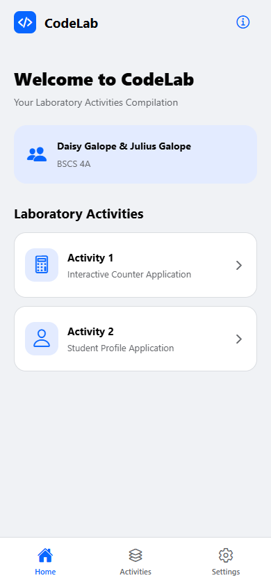
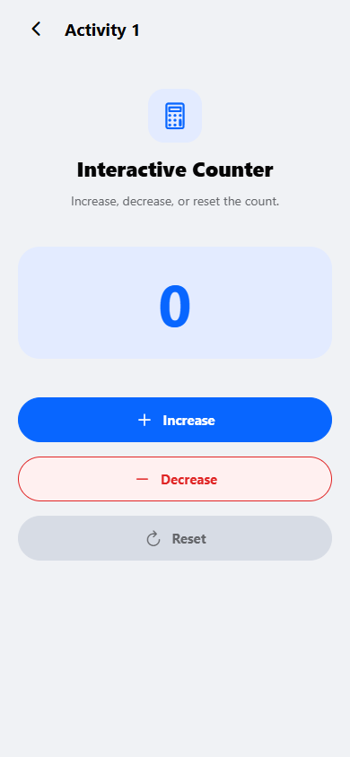
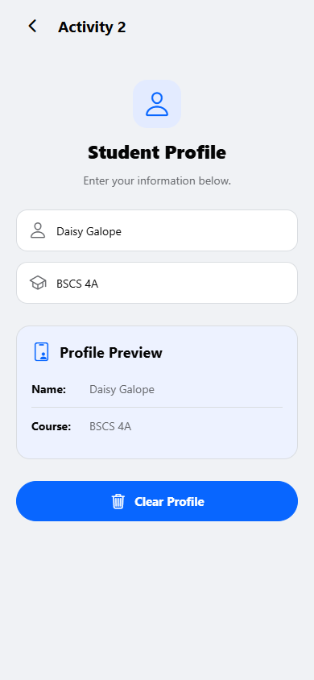
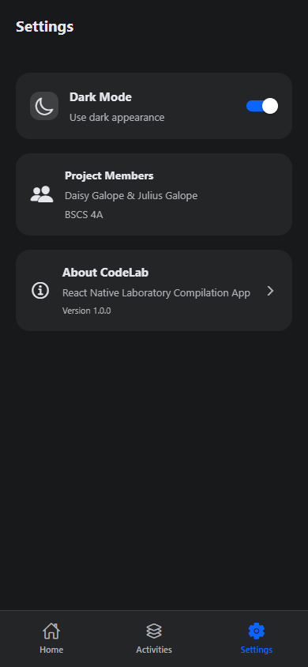

# CodeLab — Laboratory Activities Compilation App

**Developed by Daisy Galope & Julius Galope · BSCS 4A**

CodeLab is a master compilation app for current and future laboratory activities. It uses Expo SDK 58, JavaScript, React Native, Expo Vector Icons, reusable components, React hooks and React Context API.

The interface follows the reference: a blue CodeLab dashboard, three bottom tabs, a counter, a live student profile, and consistent light/dark themes.

## Preview and recording

Browser previews of the implemented screens:

| Home | Activity 1 | Activity 2 | Settings (dark) |
| --- | --- | --- | --- |
|  |  |  |  |

[Watch or download the CodeLab screen recording](docs/CodeLab-BSCS4A-Demo.mp4).

The recording is a labelled browser preview showing responsive layouts, both activities, and the shared theme toggle. Actual keyboard behavior and safe areas should also be checked on your phone.

## 1. Open the existing project

Open this project folder in VS Code. The folders and complete source files below are already created; there is no need to initialize another Expo project.

    cd "C:\Users\Daisy Galope\ReactNativeMobileApp"
    npm install

This installs the dependencies already listed in package.json. To add an Expo or React Native library in the future, use npx expo install PACKAGE_NAME so the version matches the installed SDK.

## 2. Run on your phone with Expo Go

1. Install Expo Go on your Android phone or iPhone.
2. Connect your computer and phone to the same Wi-Fi.
3. Stop any previous Metro terminal with Ctrl+C, then run:

       npx expo start --clear

4. Accept another port if Expo says the default port is occupied.
5. Scan the QR code with Expo Go on Android or the Camera app on iPhone.
6. Keep the terminal running while you use the app.

On a physical iPhone, Expo CLI and Expo Go must use the same Expo account. Run npx expo login if needed.

If the devices cannot connect on Wi-Fi, try npx expo start --tunnel and scan the new QR code. Use npm run web for a browser preview.

Official setup: https://docs.expo.dev/get-started/start-developing/

## 3. Complete source files

    ReactNativeMobileApp/
      App.js
      app.json
      package.json
      components/
        AppButton.js        # Primary, red outlined and reset buttons
        ActivityCard.js     # Clickable icon/title/arrow card
        ActivityList.js     # Shared responsive activity list
        ActivityIntro.js    # Centered activity icon and description
        MemberCard.js       # Pair names and BSCS 4A
        ProfileField.js     # Accessible input with an icon
        Screen.js           # Scroll, safe-area and keyboard handling
        ScreenHeader.js     # CodeLab header and Back navigation
        ThemeSwitch.js      # Shared theme switch
      context/
        ThemeContext.js     # Global light/dark state and palette
      config/
        brand.js            # Names, course, description and version
        activities.js       # One scalable catalog used on Home and Activities
      navigation/
        AppNavigator.js     # Stack and bottom-tab navigation
      screens/
        HomeScreen.js
        ActivitiesScreen.js
        SettingsScreen.js
        ActivityOneScreen.js
        ActivityTwoScreen.js
        AboutScreen.js
      src/app/
        _layout.tsx
        activity-one.tsx
        activity-two.tsx
        about.tsx
        (tabs)/
          _layout.tsx
          index.tsx
          activities.tsx
          settings.tsx

Screen, component, context and navigator implementations are JavaScript. The small route files only connect them to Expo Router. Expo Router supplies React Navigation bottom tabs and stack navigation, following the project's routing requirement. It owns NavigationContainer, so do not add another one.

SDK 58 uses the React Navigation APIs bundled inside Expo Router instead of application imports from external @react-navigation packages.

## 4. What to test

- **Home:** CodeLab branding, welcome heading, both members and two clickable activity cards.
- **Navigation:** Home, Activities and Settings tabs; each activity opens with a working Back button.
- **Activity 1:** Increase adds one, Decrease subtracts one, and Reset returns to zero. Negative values are supported.
- **Hooks:** useState holds the count. useEffect monitors changes and announces the new count to screen-reader users through AccessibilityInfo.
- **Activity 2:** name and course values update Profile Preview immediately. Empty fields show Not provided. Clear Profile empties both fields.
- **Keyboard:** focus both inputs on a real device and confirm the form can still be scrolled.
- **Global state:** toggle Dark Mode in Settings, then visit Home, Activities, the counter and the profile. All headers, cards, fields and text update without a reload.
- **Responsive layout:** test a narrow phone, landscape, a tablet/browser width, and larger system text.
- **About:** both the Home information icon and Settings About CodeLab card open the app information screen.

Run the automated code/configuration checks:

    npm run lint
    npm run typecheck
    npx expo-doctor
    npx expo install --check

The theme and activity form values are held in memory. They reset when the app restarts; switching tabs retains the theme. Going Back out of an activity removes its local state.

## 5. Add a future laboratory activity

1. Create a JavaScript screen in screens/.
2. Add a route re-export under src/app/.
3. Register the screen and its title in navigation/AppNavigator.js.
4. Add its id, number, title, Ionicons icon name and route href to config/activities.js.

Home and Activities read the same catalog, so the new card appears in both without duplicated screen markup.

## 6. Upload an update to your existing GitHub repository

Repository: https://github.com/disay04/React_Native_Project

Before uploading, run the validation commands above. In VS Code Source Control, stage only the application files and their deletions, including components/, config/, context/, navigation/, screens/, src/ and documentation. Keep personal tool settings out of the commit. Commit with a message such as Update CodeLab design and activities, then select Sync Changes.

If using the terminal, review git status first, stage the application changes, commit, and run:

    git push origin main

Your public source link is:
https://github.com/disay04/React_Native_Project

Local edits are not visible on GitHub until committed and pushed. Use the current CodeLab recording linked above for this version.

GitHub guide: https://docs.github.com/en/get-started/using-git/adding-a-file-to-a-repository-using-the-command-line

## 7. Prepare the new screen recording

Record approximately 1–2 minutes:

1. Show Home, CodeLab branding, both members and the two activity cards.
2. Resize the browser or rotate the phone to show the responsive layout.
3. Open Activity 1; tap Increase twice, Decrease once, then Reset.
4. Go Back; open Activity 2 and enter Daisy Galope and BSCS 4A.
5. Show the live preview, then tap Clear Profile and show Not provided.
6. Go Back; open Settings and switch Dark Mode on.
7. Return to Home and both activities to show that the theme updates globally.
8. Switch back to light mode and finish on Home.

On Android, use the phone's built-in Screen recorder. On iPhone, use Screen Recording in Control Center. A browser preview must be clearly labelled as a browser preview.

Submit the public repository link and the new CodeLab MP4, either as an attachment or a shared video link. Use the current CodeLab recording linked above.
